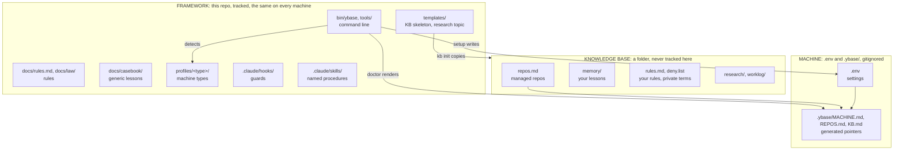
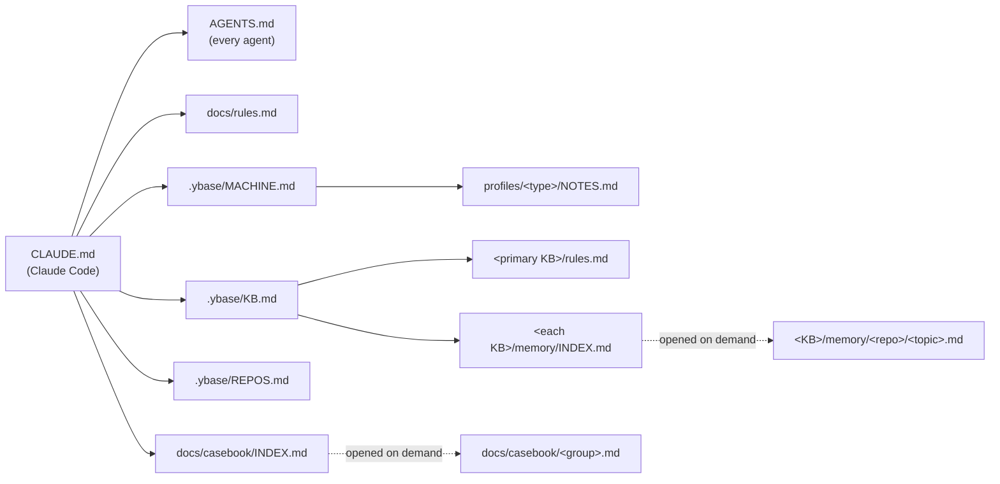
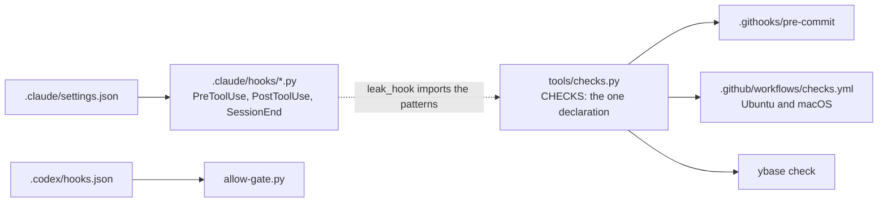

# Architecture: how YBase is built

## TL;DR

- YBase is a home repo. Agent sessions start in it, and it points at every repo you manage.
- It separates three scopes: the **framework** (this repo, the same for everyone), a **knowledge base** (your private content, never tracked here) and the **machine** (settings and generated facts for one computer).
- A session loads one short rule chain: the rules, this machine's facts, your repo list and your KB index. Everything else is opened when a task needs it.
- Two layers enforce the rules. Hooks watch Claude Code's tool calls as they happen. One check registry runs on files at commit time, in CI and on demand.

## The three scopes

| Scope | Holds | Changes when |
|---|---|---|
| Framework | how agents work, and how that is checked | a lesson becomes a rule, or a guard or check is added |
| Knowledge base | what you manage and what you learned | every day of real work |
| Machine | what this one computer has and where things are on it | you run `bin/ybase setup` or `doctor` |

**Why the split.** A rule that names a path breaks on the next machine. A lesson that names your employer cannot be shared. A machine fact written into a rule is wrong for everyone else. Each scope holds only what is true at its own level, so the framework can be published without your data.

## The rule chain

Claude Code follows the `@` imports in `CLAUDE.md`. Codex and other agents read `AGENTS.md`, which lists the same files in order. The three files under `.ybase/` are what make the chain fit one machine: the tracked files never name a machine, a path or a repo. YBase works before setup has run: `AGENTS.md` still loads, and it says to run `bin/ybase setup` to write the missing files.

`AGENTS.md` plus `docs/rules.md` stay under 1,500 words, and the `always-on-budget` check enforces it. Your KB's `rules.md` loads after the framework rules and may relax one for your own repos.

**Lesson indexes are routed, not loaded.** `docs/casebook/INDEX.md` and each KB's `memory/INDEX.md` name one group per topic with a `Covers:` line. A session opens a group only when its task matches, so the fixed cost of a session stays flat as lessons pile up.

**Rules that bind at one moment arrive at that moment.** [`docs/law/<moment>.md`](law/README.md) holds the rules for a commit, a push, a worktree, a PR, a review, a delegation, a wait, a check or a document. In Claude Code, `moment_law_hook` refuses the first such command in a session, shows the file as the reason, and lets the retry through. Codex reads the same files from the list in [`codex.md`](codex.md).

## Knowledge bases

A KB is a plain folder of Markdown. Every install has a local KB at `kb/`, whose contents git ignores. You can add more KB folders, for example one inside a notes vault or a private repo, and name one of them primary.

- New content goes to the primary KB unless a request names another.
- Reads consult every KB.
- The leak check and the leak hook read `deny.list` from every KB. The hook applies it to every commit, tag and PR command, whichever repo it targets ([ADR 0005](adr/0005-leak-hook-strict-everywhere.md)).
- YBase never commits or pushes inside a KB. A KB that is itself a repo follows its own rules.

A lesson that names anything private goes to the primary KB. A generic one is proposed for `docs/casebook/`. Layout, commands and what to store: [`kb.md`](kb.md).

## The repo list

The repos you manage are rows in `repos.md` in your primary KB: a name, what it is, an optional git remote and an optional hint for agents. A long list may be split into `repos/<area>.md` files beside it, which are read the same way. The list is private, so it never enters this repo.

Local paths are machine facts. A repo lives at `<repos root>/<name>`, where the repos root is `YBASE_REPOS_ROOT` in `.env` and defaults to the folder that holds YBase. `YBASE_REPO_PATH_<NAME>` overrides one repo's path on one machine.

`ybase repos render` joins the list with this machine's paths into `.ybase/REPOS.md`, one line per repo. Every session loads that file. An agent reaches a repo by its path (`git -C <path>`), or clones it on demand with `ybase repos clone NAME`. A worktree for a managed repo goes under the profile's worktree folder, in a folder per repo.

Machine profiles and the `.env` keys are described in [`machines.md`](machines.md).

## Enforcement

The check registry runs on files: at commit, in CI and on demand. The hooks run on Claude Code's tool calls, the only layer that can see a `gh pr create` or a `pgrep` that is never committed. A hook that crashes or cannot decide allows the call, so a broken guard never stops all work.

### Hooks

| Hook | Kind | On by default | Refuses or does |
|---|---|---|---|
| `allow-gate` | approver | no: `YBASE_ALLOW_GATE=1` | approves a compound shell command when every part matches an allow rule; otherwise the normal permission prompt decides. Best-effort parsing with known gaps ([ADR 0003](adr/0003-allow-gate-is-opt-in.md)): a convenience, not a security boundary |
| `file-guard` | blocking | yes | a Write or Edit on a path that matches `.claude/file-guard`, such as `.env` or a key file |
| `filesystem_scan_hook` | blocking | yes | a recursive search rooted at `/`, a home folder or a network mount root |
| `self_matching_pgrep_hook` | blocking | yes | a `pgrep -f` or `pkill -f` whose pattern matches the command running it |
| `zsh_word_split_hook` | blocking | yes | a bare `$VAR` in a `for` list or after `set --` when the shell is zsh, which does not split it |
| `python_floor_hook` | blocking | yes | `python` below the `requires-python` floor of the nearest `pyproject.toml` |
| `leak_hook` | blocking | yes | a commit message, tag message, staged line or PR text that trips the `leaks` patterns or a KB's `deny.list`. The rules are the same in every repo ([ADR 0005](adr/0005-leak-hook-strict-everywhere.md)); the only escape is the `LEAK_AUTHORIZED=1` prefix |
| `moment_law_hook` | once per moment | yes | the first command of a moment, until its `docs/law/` file has been shown |
| `readonly_checkout_hook` | blocking | no: `YBASE_GUARD_READONLY_CHECKOUT=1` | a Write or Edit into the main checkout instead of a worktree |
| `pr_draft_hook` | blocking | no: `YBASE_GUARD_PR_DRAFT=1` | a PR opened as ready for review, or marked ready |
| `git_write_in_pipeline_hook` | advisory | yes | warns when a pipe or a later command hides a git write's exit status |
| `writing_style_hook` | advisory | yes | style and link findings on the Markdown file just written |
| `tool_load_hook` | recording | yes | records host load after each tool call, for `retro` |
| `session_end_distil_hook` | recording | yes | distils the closed session, for `retro` |

The two opt-in guards enforce a working style, not a safety property, so they ship off. The rules they enforce still stand: [rule 15](rules.md#working) and [`law/pr.md`](law/pr.md). Turn a guard on with its key in `.env`.

Each hook's docstring says what it refuses, what passes and how to get past it. `ybase hooks install-user` registers five guards in the user-level Claude Code settings: `filesystem_scan_hook`, `self_matching_pgrep_hook`, `zsh_word_split_hook`, `pr_draft_hook` and `leak_hook`. A session started inside a managed repo, or in the folder above your repos, then still gets them.

### Escapes and switches

A guard that is wrong about one command has a door for that command. The door is a named variable written as a prefix on the command, so a later reader sees it on the same line. Using a guard's own door for the case it names is not routing around the guard. [Rule 33](rules.md#safety) forbids the rest: turning a guard off, editing it without an ADR, or spelling a command so that the guard does not recognise it.

| Hook | Variable | Where it is set |
|---|---|---|
| `leak_hook` | `LEAK_AUTHORIZED=1` | prefix on the command |
| `moment_law_hook` | `LAW_SKIP=1` | prefix on the command; the session's environment for Write, Edit and Agent |
| `filesystem_scan_hook` | `SCAN_WIDE=1` | prefix on the command, or the session's environment |
| `self_matching_pgrep_hook` | `PGREP_SELF_OK=1` | prefix on the command |
| `zsh_word_split_hook` | `WORD_SPLIT_OK=1` | prefix on the command |
| `python_floor_hook` | `PYTHON_FLOOR_OK=1` | prefix on the command |
| `pr_draft_hook` | `PR_READY_AUTHORIZED=1` | prefix on the command, only when the user asked for a ready PR |
| `readonly_checkout_hook` | `MAIN_CHECKOUT_WRITE=1` | the session's environment |
| `writing_style_hook` | `WRITING_STYLE_SKIP=1` | the session's environment |
| `file-guard` | none | the user makes the refused write by hand |

The two recording hooks write to `.ybase/` on this machine and send nothing anywhere. `YBASE_RETRO_OFF=1` in the environment Claude Code starts in turns the session-end distil off. `YBASE_RETRO_DRY_RUN=1` makes it print what it would record and write nothing.

Codex runs one of these hooks: the allow gate, wired in `.codex/hooks.json` and off unless `YBASE_ALLOW_GATE=1`. It reads every other guard as a rule ([`codex.md`](codex.md)).

### Checks

| Check | Refuses |
|---|---|
| `links` | a relative Markdown link to a missing file |
| `leaks` | keys, tokens, personal paths, emails or any term in a KB's `deny.list`, in files and in commit messages |
| `casebook-router` | a casebook group the index does not reach, or a trigger with no entry |
| `skills` | a skill whose `SKILL.md` misnames it, lacks a one-line description or has no contract row, and a broken `.agents/skills` link for Codex |
| `no-tracked-state` | tracked machine state (`.env`, `.ybase/`, `tmp/`) or KB content under `kb/` |
| `framework-style` | an em dash in framework prose |
| `hooks` | a hook that `.claude/settings.json` does not wire, a wired hook that does not exist, or a hook with no docstring |
| `law` | a moment in `moment_law_hook` with no `docs/law/<moment>.md`, or a law file no moment reaches |
| `always-on-budget` | `AGENTS.md` plus `docs/rules.md` over 1,500 words, or a numbered rule over 50 words |

Each check reports how much it scanned. A check that silently looked at nothing shows `scanned 0` instead of a plain pass.

**The deny list is local on purpose.** A tracked list of private terms would publish the very terms it protects. `bin/ybase setup` creates `deny.list` in your primary KB; fill it before you publish anything.

## Writing

[`writing.md`](writing.md) is the always-on page. [`writing/README.md`](writing/README.md) maps each kind of document to a register, and each register says who reads it and what it owes them. `writing_style_hook` prints the mechanical findings after each Write or Edit; the `proofread` skill does the judgment half.
