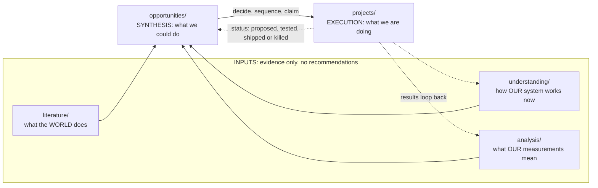

# The pipeline: where a document belongs

Every case is organized by the same five stages. They are not peers: they form a directed pipeline from evidence to committed work, and results flow back. Knowing which stage you are standing in decides where an update goes.



A case uses only the stages it needs and lists them in its `CASE.md` frontmatter. A literature-only case is valid; it simply may not recommend anything, because recommending is the job of `opportunities/`.

## The stages

### literature

**What the world does.** One external source per note in `papers/<slug>.md` (lowercase kebab-case of a distinctive short name), many sources on one topic in `deep_dives/`. A note describes; it never ranks, decides or plans.

Minimum note shape (a case may require more keys through `note_required_keys`):

```markdown
---
title: "<full title>"
url: <primary surface>
date: <YYYY-MM>
read_date: <YYYY-MM-DD>
---

# <title>

**TL;DR:** what they did, and the takeaway.

## Problem
## Solution
## Novelty
## Results
## Artifacts      (code, weights, data, demo: what was found when read)
## Caveats        (limits of the source, and any disagreement between its surfaces)
```

Read code, weights and data rather than only checking that the links resolve. Where surfaces disagree, the executable one decides and the disagreement goes in `## Caveats`. Every note gets a row in the case catalog in the same change.

### understanding

**How our system works now.** Living documents keyed by subsystem, rewritten when the system changes, each ending with an append-only `## History`. They state what the system does, with `file:line` references, not what it should do.

### analysis

**What our measurements mean.** Dated and immutable: `analysis/<YYYY-MM-DD>_<slug>.md`, one question per document, with a header naming its `question:`, `status:`, `as-of:` and the `facts:` it cites. A changed mind is a new document, not an edit.

### opportunities

**What we could do.** The only place an idea may be proposed, and only once it is triangulated on four legs: the external evidence (`[lit]`), what our system does today (`[code]`), what we measured (`[run]`), and whether it was already tried (`[status]`). A leg with nothing behind it is written out in words, never dropped.

### projects

**What we are doing.** A candidate becomes a project with a decision, a dependency order, a validation plan and a claim on a task board. An experiment's record is written before it launches: design, hypothesis and falsifier first, then the exact plan, then results.

## The epistemic layers

Across the stages, three kinds of claim live in three places. The test is mechanical: would **re-running** change it, or would **re-thinking** change it?

| Layer | Changes when you | Lives in | Lifecycle |
|---|---|---|---|
| **Fact** | re-run | the experiment's own record under `projects/` | written before launch, results appended |
| **Inference** | re-think | `analysis/` | dated, immutable |
| **Truth** | both settle | `understanding/` | living, with append-only history |

The second analysis on one topic promotes the picture up a layer, into `understanding/`.

## Outside the pipeline

- `memory/`: lessons about how to work, shared by every case.
- `worklog/`: what happened when, one file per week, append-only.
- `profiles/`: what is true of each machine type.
